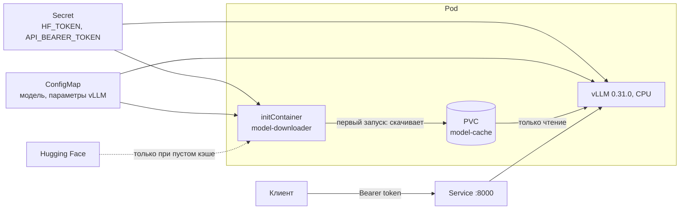

# vLLM на CPU в Kubernetes

Тестовое задание на позицию Data Engineer (стажёр), команда исследования технологий машинного обучения. Перепелюк И.А.

Репозиторий разворачивает OpenAI-совместимый сервер vLLM 0.31.0 с моделью `Qwen/Qwen2.5-1.5B-Instruct` в Minikube. Инференс идёт только на CPU, в bfloat16 без квантизации. Контейнеры работают от непривилегированных пользователей, веса кэшируются на PVC, токены передаются через Secret, параметры vLLM задаются через ConfigMap, а промпты и ответы модели в логи не попадают.



## Структура

```
Dockerfile                  образ vLLM: rootless, зависимости из requirements.txt
requirements.txt            154 зафиксированные зависимости, включая транзитивные
requirements.in             прямые зависимости vLLM 0.31.0 для CPU (вход для lock.sh)
downloader/Dockerfile       лёгкий distroless-образ для initContainer
downloader/requirements.txt зависимости загрузчика (huggingface_hub)
src/vllm_privacy/           фильтр логов и ASGI middleware: факт запроса и Bearer-авторизация
config/logging.json         конфиг логирования vLLM в формате JSON
scripts/download_model.py   загрузка весов в PVC, при повторном запуске без сети
scripts/entrypoint.sh       запуск vLLM, приватные настройки фиксируются здесь
scripts/lock.sh             воспроизводимая генерация requirements.txt
k8s/base/                   манифесты: namespace, PVC, Deployment, Service, генераторы ConfigMap и Secret
k8s/overlays/minikube/      оверлей для Minikube (локальные образы)
loadtest/loadtest.py        нагрузочный тест: TTFT, latency, TPOT, throughput
tests/                      тесты фильтра, middleware и загрузчика
```

## Запуск в Minikube

Нужны Docker Desktop (на Windows с бэкендом WSL2), [minikube](https://minikube.sigs.k8s.io/docs/start/) и kubectl, процессор x86_64 с AVX2 или AVX-512. Модели 1.5B хватает 8 ГБ памяти пода, поэтому Minikube получает 12 ГБ.

Команды ниже даны для PowerShell. В bash отличается только создание файла с секретами.

1. Запустить кластер:

   ```powershell
   minikube start --driver=docker --cpus=6 --memory=12g --disk-size=40g
   ```

2. Собрать оба образа сразу внутри Minikube, без реестра. Первая сборка vLLM качает около 1 ГБ колёс:

   ```powershell
   minikube image build -t vllm-cpu:0.31.0 .
   minikube image build -t model-downloader:1.0.0 -f downloader/Dockerfile .
   ```

3. Создать файл с секретами. `HF_TOKEN` нужен только для закрытых моделей, для Qwen его можно оставить пустым:

   ```powershell
   $token = [guid]::NewGuid().ToString("N") + [guid]::NewGuid().ToString("N")
   "HF_TOKEN=`nAPI_BEARER_TOKEN=$token" | Set-Content -NoNewline k8s/base/secrets.env
   ```

   В bash: `printf 'HF_TOKEN=\nAPI_BEARER_TOKEN=%s\n' "$(openssl rand -hex 20)" > k8s/base/secrets.env`. Файл указан в `.gitignore`.

4. Развернуть и дождаться готовности. При первом запуске initContainer скачивает около 3 ГБ, затем vLLM загружает модель:

   ```powershell
   kubectl apply -k k8s/overlays/minikube
   kubectl -n llm logs -f deploy/vllm -c model-downloader
   kubectl -n llm wait --for=condition=Available deploy/vllm --timeout=20m
   ```

5. Открыть доступ и отправить запрос:

   ```powershell
   kubectl -n llm port-forward svc/vllm 8000:8000
   ```

   ```powershell
   $token = (Get-Content k8s/base/secrets.env | Select-String "API_BEARER_TOKEN=").Line.Split("=")[1]
   $body = @{model = "qwen2.5-1.5b-instruct"; messages = @(@{role = "user"; content = "Что такое Kubernetes?"}); max_tokens = 64} | ConvertTo-Json -Depth 4
   Invoke-RestMethod http://localhost:8000/v1/chat/completions -Method Post -ContentType "application/json" -Headers @{Authorization = "Bearer $token"} -Body $body
   ```

   Без токена сервер отвечает `401`.

Проверка кэша: после `kubectl -n llm rollout restart deploy/vllm` лог initContainer пишет `Model Qwen/Qwen2.5-1.5B-Instruct@main found in /models/..., skipping download`, и под стартует без обращения к Hugging Face.

Удаление: `kubectl delete -k k8s/overlays/minikube`. PVC с весами удаляется вместе с namespace.

## Как выполнены требования

| Требование | Реализация |
|---|---|
| Kubernetes или Minikube | манифесты в `k8s/`, проверены по схемам Kubernetes 1.34 в строгом режиме |
| Instruct-модель, только CPU | `Qwen/Qwen2.5-1.5B-Instruct`, bfloat16; официальное CPU-колесо vLLM и torch `2.13.0+cpu`, CUDA-пакетов в образе нет |
| vLLM 0.27.0 или выше | 0.31.0 |
| Rootless-контейнер | `USER 10001` в образе; в поде `runAsNonRoot`, сброшены все capabilities, `allowPrivilegeEscalation: false`, корневая файловая система только для чтения, seccomp `RuntimeDefault`; namespace требует Pod Security `restricted` |
| Зафиксированные зависимости | `requirements.txt`: 154 пакета с точными версиями, включая транзитивные; установка с `--no-deps --only-binary :all:`, затем `pip check` |
| Логи без промптов и ответов | `src/vllm_privacy/filters.py` + `config/logging.json`, подробнее ниже |
| PVC и кэш весов | initContainer скачивает модель в PVC и пишет маркер; при следующих запусках выходит сразу, основной контейнер работает с `HF_HUB_OFFLINE=1` и монтирует PVC только для чтения |
| Secret | `secretGenerator` создаёт Secret из `secrets.env`: `HF_TOKEN` для загрузчика, `API_BEARER_TOKEN` для сервера |
| ConfigMap | `vllm-config.yaml` передаётся в `vllm serve --config`; `model.env` и `runtime.env` задают модель и переменные `VLLM_CPU_*` |
| Бонус 1: kustomize | `kubectl apply -k k8s/overlays/minikube` |
| Бонус 2: initContainer | `downloader/Dockerfile`: distroless Python, без оболочки, пользователь 65532; в поде запускается от 10001 |
| Бонус 3: нагрузочный тест | `loadtest/loadtest.py`, результаты и аналитика ниже |

### Приватное логирование

vLLM печатает содержимое запросов в четырёх местах: `RequestLogger` (промпт на уровне DEBUG, параметры на INFO), тело запроса на DEBUG, сгенерированный текст при `--enable-log-outputs` и отладочный дамп ответов при `VLLM_DEBUG_LOG_API_SERVER_RESPONSE`. При падении движка `dump_input` вдобавок пишет `SamplingParams` запроса, а там бывают стоп-строки и JSON-схемы пользователя.

Исходники vLLM не патчатся: используются штатные точки расширения, поэтому решение переживает обновление версии.

- `config/logging.json` подключается через `VLLM_LOGGING_CONFIG_PATH`. vLLM применяет его в каждом процессе, включая процесс движка. Логи выводятся в JSON, на обработчике стоит фильтр `RedactRequestContent`.
- Фильтр оставляет от записей `RequestLogger` только факт: `Received request <id>` и `Generated response <id>: finish_reason=...`. Остальные записи с аргументами он отбрасывает, поэтому если в новой версии vLLM поменяется формат сообщения, содержимое не утечёт, а запись просто пропадёт. Дампы ответов и данные запросов из `dump_input` тоже отбрасываются.
- `AccessLogMiddleware` пишет строку на каждый HTTP-запрос: ID (из `X-Request-Id` или сгенерированный), метод, путь, статус, размеры запроса и ответа, время до первого байта и общее время. Тела запроса и ответа он не читает.
- `entrypoint.sh` выставляет эти настройки сам и снимает `VLLM_DEBUG_LOG_API_SERVER_RESPONSE`, поэтому значения из ConfigMap их не переопределят. Фильтр работает, даже если в ConfigMap включить `enable-log-outputs`.

Так выглядит лог одного потокового запроса:

```json
{"level": "INFO", "logger": "vllm.entrypoints.serve.utils.request_logger", "process": "APIServer", "message": "Received request chatcmpl-test-stream-1"}
{"level": "INFO", "logger": "vllm.entrypoints.serve.utils.request_logger", "process": "APIServer", "message": "Generated response chatcmpl-test-stream-1 (streaming complete): finish_reason=streaming_complete"}
{"level": "INFO", "logger": "vllm_privacy.access", "process": "APIServer", "message": "request", "request_id": "test-stream-1", "method": "POST", "path": "/v1/chat/completions", "status": 200, "request_bytes": 126, "response_bytes": 3732, "duration_ms": 38.8, "first_byte_ms": 14.5, "client": "10.244.0.1"}
```

### Авторизация

Встроенный `--api-key` vLLM защищает только пути `/v1`, `/v2` и `/inference`. Путь `/invocations` с той же генерацией остаётся открытым, об этом прямо сказано в документации vLLM. Поэтому авторизацию выполняет `BearerAuthMiddleware`: он требует `Authorization: Bearer <API_BEARER_TOKEN>` на всех путях, кроме `/health`, `/ping` и `/version`, которые нужны пробам Kubernetes. Токен сравнивается за постоянное время.

### Параметры CPU

В Kubernetes лимит CPU задаётся квотой cgroup, а не набором ядер. Поэтому привязка потоков `auto` видит все ядра ноды и запускает лишние потоки OpenMP. В ConfigMap стоит `VLLM_CPU_OMP_THREADS_BIND=nobind`, а `entrypoint.sh` вычисляет `OMP_NUM_THREADS` из `/sys/fs/cgroup/cpu.max` и оставляет одно ядро под HTTP-сервер.

## Что проверено

Образ собирается у вас: в моей среде нет доступа к Docker Hub, Hugging Face и индексу PyTorch. Остальное проверено до сдачи.

- vLLM 0.31.0 запущен через `entrypoint.sh` на маленькой случайной модели архитектуры Qwen2 от пользователя с UID 10001, с домашним каталогом только для чтения, как в поде. Без токена `/v1/*`, `/invocations` и `/metrics` отвечают `401`, `/health` отвечает `200`. Конфиг при этом включал `enable-log-requests`, `enable-log-outputs` и `VLLM_DEBUG_LOG_API_SERVER_RESPONSE=1`, но ни метка из промпта, ни стоп-слово, ни сгенерированный текст в лог не попали. Ошибок записи на диск не было: vLLM пишет только в `~/.cache` и `/tmp`, которые смонтированы как `emptyDir`.
- `vllm-config.yaml` из ConfigMap разобран парсером аргументов vLLM 0.31.0.
- Манифесты проверены по схемам Kubernetes 1.34 в строгом режиме и на требования Pod Security `restricted`.
- `requirements.txt` разрешается целиком из готовых колёс для Python 3.12 и linux/amd64.
- 22 теста: `python -m pytest` (нужны `pytest` и `python-json-logger`).

## Бонус 3: нагрузочное тестирование

Скрипт отправляет потоковые запросы к `/v1/chat/completions` с фиксированной длиной ответа (`ignore_eos`) и считает TTFT, полную задержку, время на токен (TPOT) и пропускную способность. В начало каждого промпта добавляется уникальная метка: иначе vLLM переиспользует KV-кэш одинакового длинного промпта (prefix caching), и TTFT длинного промпта окажется таким же, как у короткого.

```powershell
pip install -r loadtest/requirements.txt
python loadtest/loadtest.py --token $token --concurrency 1 4 --requests 8 --max-tokens 64
```

Сценарии: короткий промпт и длинный (30 повторов абзаца, `--long-repeat`), конкурентность 1 и 4. Фактическое число токенов промпта берётся из ответа сервера и показано в таблице. Таблица сохраняется в `loadtest/results/results.md`.

> Таблица результатов добавляется после прогона на целевой машине: `loadtest/results/results.md`.

### Какие параметры менять для роста throughput

#### А. Большой поток коротких запросов

Здесь узкое место в декодировании: каждый шаг генерации читает все веса модели из памяти, и чем больше последовательностей идёт в одном батче, тем дешевле токен.

- `--max-num-seqs`: поднять (у нас 16), чтобы в батч попадало больше одновременных запросов. Расплата растёт TPOT каждого отдельного запроса.
- `VLLM_CPU_KVCACHE_SPACE`: должно хватать KV-кэша на все одновременные последовательности, иначе планировщик вытесняет запросы. Короткий контекст позволяет держать много последовательностей при умеренном объёме.
- `--max-model-len`: уменьшить до реально нужного, чтобы не резервировать память под длинный контекст.
- `--enable-prefix-caching` (уже включён): если у запросов общий системный промпт, его префилл считается один раз.
- `--api-server-count`: больше одного процесса API-сервера, чтобы токенизация и HTTP не упирались в одно ядро. Вместе с этим `VLLM_CPU_NUM_OF_RESERVED_CPU` резервирует под них ядра.
- Квантование весов (AWQ, GPTQ или INT8 W8A8 поддерживаются на x86) уменьшает объём памяти, читаемой на шаге декодирования.
- Горизонтальное масштабирование: несколько реплик за Service, если ядер ноды хватает.

#### Б. Мало запросов с большим контекстом

Здесь узкое место в префилле (TTFT) и в объёме KV-кэша, который растёт линейно с длиной контекста.

- `--max-model-len` и `VLLM_CPU_KVCACHE_SPACE`: поднять под нужный контекст. Иначе запрос либо отклоняется, либо вытесняется.
- `--max-num-batched-tokens`: поднять (у нас 2048). Chunked prefill делит длинный промпт на куски такого размера, и крупный кусок даёт меньше шагов префилла и лучший TTFT. Расплата: на время префилла дольше ждут декодирующиеся запросы.
- `--kv-cache-dtype fp8`: CPU-бэкенд vLLM 0.31 его поддерживает. KV-кэш становится вдвое меньше, при той же памяти помещается вдвое больший контекст, а чтение кэша при декодировании ускоряется. Возможна небольшая потеря точности.
- `--max-num-seqs`: держать небольшим, чтобы память шла на длину контекста, а не на число последовательностей.
- `--enable-prefix-caching`: даёт большой выигрыш, если длинный контекст повторяется (одни и те же документы в RAG, многоходовый диалог).
- На многосокетном сервере: `--tensor-parallel-size` по числу NUMA-узлов с `VLLM_CPU_OMP_THREADS_BIND=0-31|32-63`, чтобы каждый процесс работал со своей памятью.

## Компромиссы и что можно улучшить

- vLLM в контейнере выводит предупреждение `get_mempolicy: Operation not permitted`. Документация vLLM подтверждает, что работа от этого не страдает, отключаются только NUMA-оптимизации. Чтобы их включить, нужны `SYS_NICE` и ослабленный seccomp, а это противоречит требованию безопасности. Для однонодового Minikube выигрыш от NUMA нулевой.
- Базовые образы указаны тегами. В продакшене их стоит закрепить по digest, а `requirements.txt` дополнить хешами (`--require-hashes`).
- Реплика одна: PVC с режимом `ReadWriteOnce` и стратегия `Recreate`. Для нескольких реплик нужен `ReadWriteMany` или отдельный кэш на каждую реплику.
- Сообщения исключений vLLM не фильтруются по содержимому. Сейчас ни одно из них не включает текст промпта, но для гарантии можно добавить в фильтр очистку `exc_info`.
- NetworkPolicy не добавлена: стандартный CNI Minikube её не применяет.
